<div align="center">

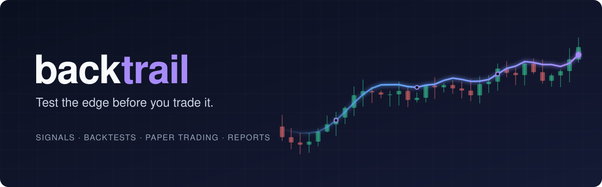

<br/>

**Find out whether a trading strategy really works before you trust it with money.**

backtrail pulls hourly market data, turns it into strategy signals, backtests them with realistic costs,
runs them live on paper portfolios, and tells you when reality starts drifting from the backtest.

<br/>


[Features](#-what-it-does) · [How it works](#-how-it-works) · [Quick start](#-quick-start) · [Dashboard](#%EF%B8%8F-dashboard) · [Architecture](#%EF%B8%8F-architecture) · [Disclaimer](#%EF%B8%8F-disclaimer)

<br/>

<picture>
  <source media="(prefers-color-scheme: dark)" srcset=".github/assets/screenshots/overview-dark.png"/>
  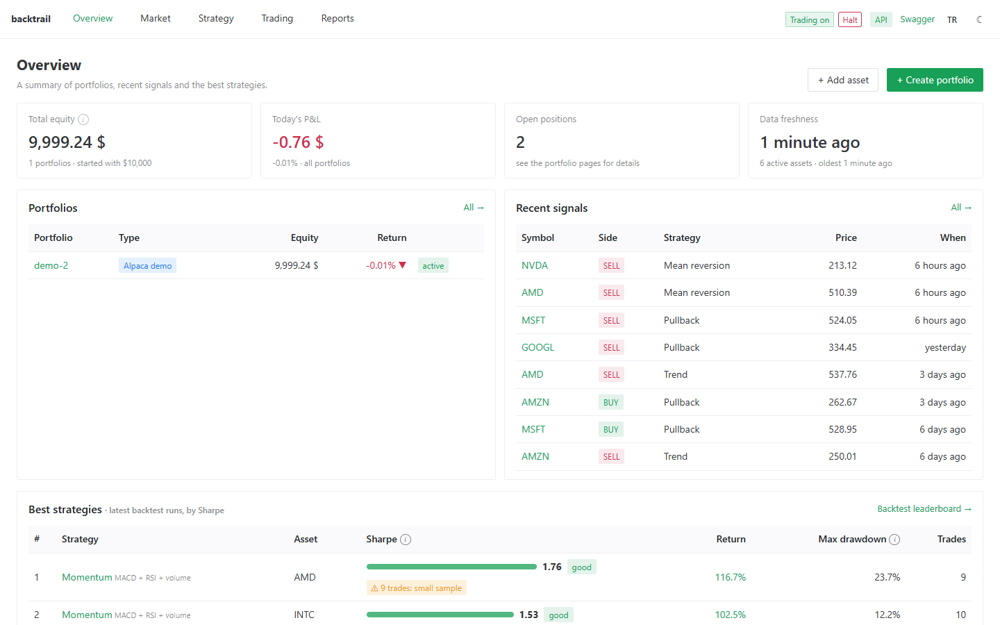
</picture>

</div>

---

> [!WARNING]
> **backtrail is a simulation and research tool, not investment advice.** It never trades real money.
> Signals, backtests and paper results are hypothetical. Read the [disclaimer](#%EF%B8%8F-disclaimer) before relying on anything it shows.

## 🤔 Why?

Most strategies look great in a chart and fall apart in practice: fees eat the edge, the parameters were
overfitted, or the live fills simply do not match the test. backtrail is built around one question:

> **Does what I tested match what actually happens?**

So the same execution code runs the backtest *and* the paper portfolio. A strategy subscription on a paper
portfolio produces **exactly** the trades its backtest produces on the same bars, and a divergence report
proves it (PnL difference: `0`). When live trades later drift from the backtest's expectation, a health check
flags the strategy and pings you on Telegram.

## ✨ What it does

| | |
|---|---|
| 📈 **Market data** | 1h bars from Yahoo Finance for US equities, ETFs, indexes and commodity futures, aggregated to 4h session-aware bars (NYSE hours with DST, or 24/7 UTC buckets). Up to ~2 years of history, synced minutes after every bar closes. |
| 🧠 **Signals** | 11 indicators (EMA, RSI, MACD, Bollinger, ATR, ADX, Donchian, Supertrend, ...) feeding 5 rule-based strategies plus a buy & hold benchmark. Deterministic, no look-ahead. |
| 🧪 **Backtesting** | Event-driven engine with fees, slippage, minimum fees, position sizing, stop-loss / take-profit and gap fills. Parameter sweeps, **walk-forward** analysis, **Monte Carlo** of trade order, futures **roll adjustment**, an **earnings filter** and **short** selling. |
| 💼 **Paper trading** | Multi-asset simulated portfolios with risk rules, strategy subscriptions and manual orders, marked to near-live quotes. |
| 🏦 **Broker demo** | The same decisions sent to an **Alpaca paper account**: bracket orders, WebSocket fills, idempotent order ids, automatic reconciliation. |
| 🛑 **Safety** | Global and per-portfolio kill switch, audit log, Basic Auth, and live trading blocked at config level. |
| 📊 **Reports** | Strategy × asset matrix, signal quality (returns 1/3/6/12 bars after a signal), backtest vs. live divergence, trade journal with CSV export. |
| 🔔 **Notifications** | Telegram messages for fresh signals, fills, halts and strategy-health warnings. |
| 🖥️ **Web UI** | Vue 3 dashboard with candlestick charts, light/dark theme and a phone-friendly layout. |

## 🔁 How it works

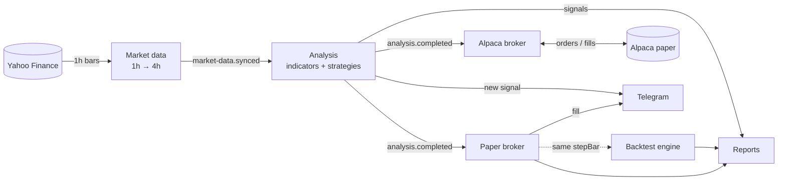

Every 4h bar follows the same rules everywhere:

1. A pending order fills at the bar's **open**.
2. Stop and take-profit are checked inside the bar (stop wins if both are hit; a gap fills at the open).
3. Equity is marked at the **close**.
4. The strategy decides; its order fills at the **next** bar's open.

## 🧠 Strategies

| Code | Idea | Short |
|---|---|:---:|
| `trend_ema_adx` | EMA crossover, confirmed by ADX strength and an EMA200 trend filter | ✅ |
| `breakout_donchian_atr` | Donchian channel breakout with expanding ATR and volume | ✅ |
| `meanrev_bb_rsi` | Bollinger + RSI mean reversion, only with the trend | |
| `momentum_macd_rsi_vol` | MACD momentum with RSI and volume confirmation | |
| `pullback_supertrend_rsi` | Buy the pullback inside a Supertrend uptrend when RSI turns | |
| `buy_and_hold` | Benchmark | |

Each strategy has typed, validated parameters and can have many named configs. Adding one is a single file:
define it with `defineStrategy()` and add it to the registry.

## 🚀 Quick start

**Requirements:** Node.js 24.22.1 (see `.nvmrc`) and Docker.

```bash
cp .env.example .env
docker compose up -d          # PostgreSQL on localhost:5434
npm install
npm run migration:run
npm run start:dev             # http://localhost:3000/api
```

Then open the dashboard:

```bash
npm run web:install
npm run web:dev               # http://localhost:5173
```

- Swagger UI: http://localhost:3000/api/docs
- Health check: http://localhost:3000/api/health

> [!TIP]
> Add a symbol and wait a few seconds. It is backfilled with ~2 years of history, signals are generated
> immediately, and from then on it syncs on its own a few minutes after each hourly bar closes.

## 🖥️ Dashboard

Everything is driven from the web UI: no `curl` needed. It speaks English and Turkish (switch in the header;
the first visit follows the browser language), every technical term has an ⓘ explanation, and the layout
works on a phone.

| Screen | What you do there |
|---|---|
| **Overview** | See portfolios, recent signals and the system state at a glance. |
| **Assets** | Search and add symbols, read candlestick charts with indicators, see what each strategy thinks right now. |
| **Signals** | Browse and filter every buy/sell signal the strategies produced. |
| **Strategies** | Inspect the strategy catalog and create your own parameter sets. |
| **Backtests** | Run single tests, parameter sweeps and walk-forward analyses; compare them on a leaderboard; open equity curves, trades and Monte Carlo results. |
| **Portfolios** | Create paper or Alpaca demo portfolios, subscribe strategies, place orders, watch positions, equity and strategy health; hit the kill switch. |
| **Reports** | Strategy × asset matrix, signal quality, backtest vs. live divergence, trade journal with CSV export. |
| **Audit** | Every user and system action, in order. |

<table>
  <tr>
    <td width="50%">
      <picture>
        <source media="(prefers-color-scheme: dark)" srcset=".github/assets/screenshots/asset-chart-dark.png"/>
        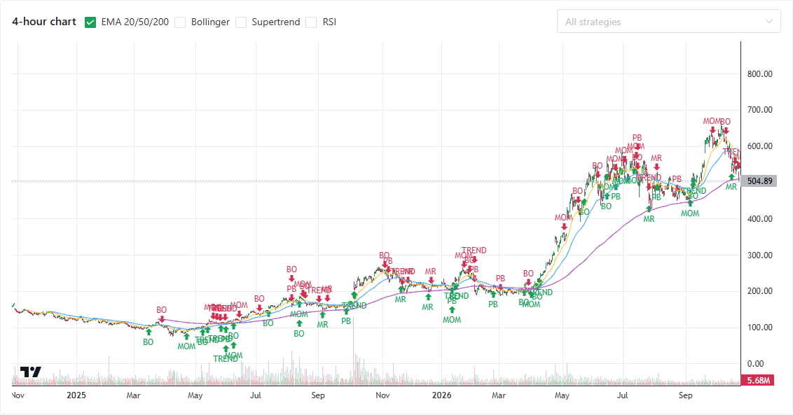
      </picture>
      <p align="center"><sub><b>Assets</b>: 4h chart with indicators and every strategy's signals</sub></p>
    </td>
    <td width="50%">
      <picture>
        <source media="(prefers-color-scheme: dark)" srcset=".github/assets/screenshots/signals-dark.png"/>
        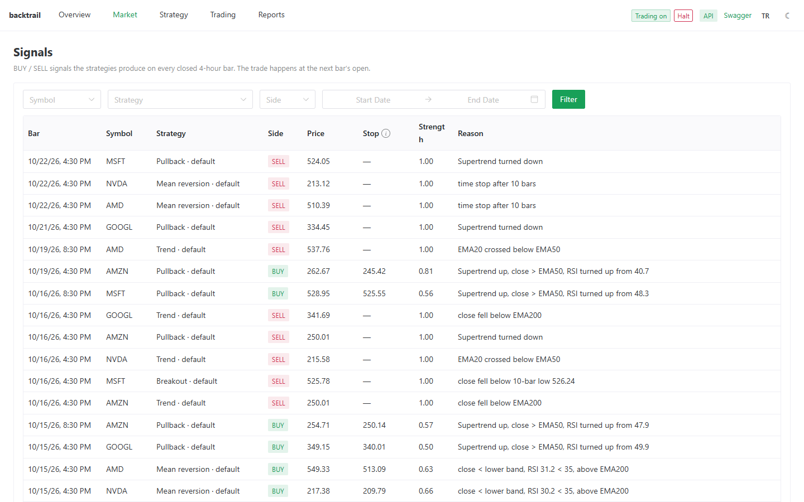
      </picture>
      <p align="center"><sub><b>Signals</b>: every buy/sell with its stop and reason</sub></p>
    </td>
  </tr>
  <tr>
    <td>
      <picture>
        <source media="(prefers-color-scheme: dark)" srcset=".github/assets/screenshots/backtests-dark.png"/>
        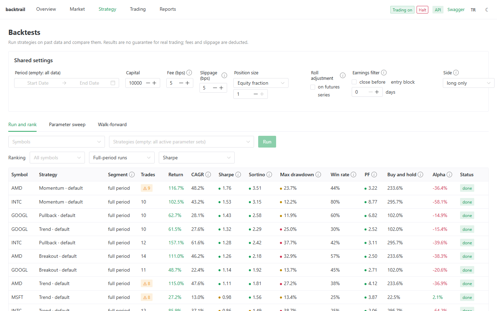
      </picture>
      <p align="center"><sub><b>Backtests</b>: run, sweep, walk-forward and the leaderboard</sub></p>
    </td>
    <td>
      <picture>
        <source media="(prefers-color-scheme: dark)" srcset=".github/assets/screenshots/backtest-detail-dark.png"/>
        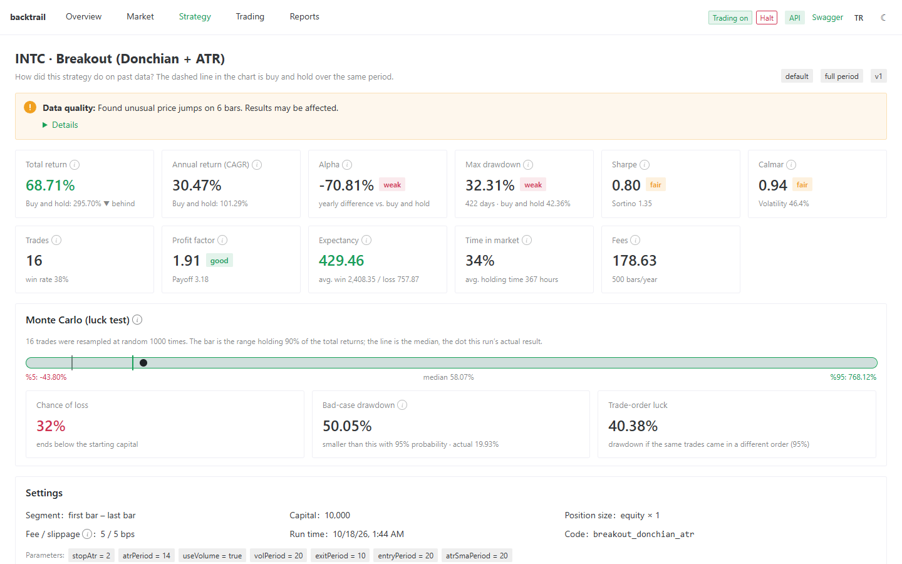
      </picture>
      <p align="center"><sub><b>Backtest detail</b>: rated metrics, data quality and Monte Carlo</sub></p>
    </td>
  </tr>
  <tr>
    <td>
      <picture>
        <source media="(prefers-color-scheme: dark)" srcset=".github/assets/screenshots/portfolio-dark.png"/>
        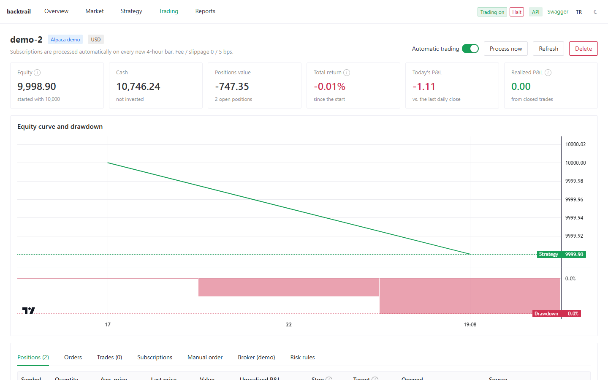
      </picture>
      <p align="center"><sub><b>Portfolio</b>: equity, drawdown, positions and orders</sub></p>
    </td>
    <td>
      <picture>
        <source media="(prefers-color-scheme: dark)" srcset=".github/assets/screenshots/reports-dark.png"/>
        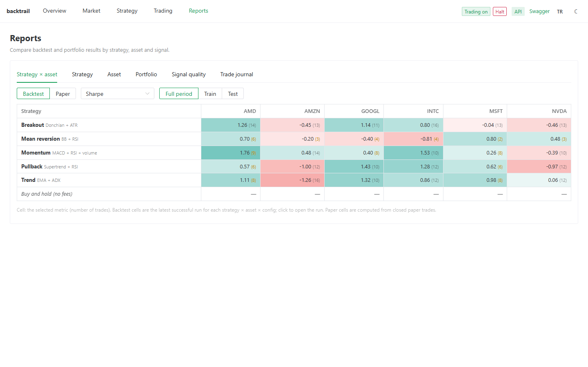
      </picture>
      <p align="center"><sub><b>Reports</b>: strategy × asset matrix</sub></p>
    </td>
  </tr>
  <tr>
    <td>
      <picture>
        <source media="(prefers-color-scheme: dark)" srcset=".github/assets/screenshots/strategies-dark.png"/>
        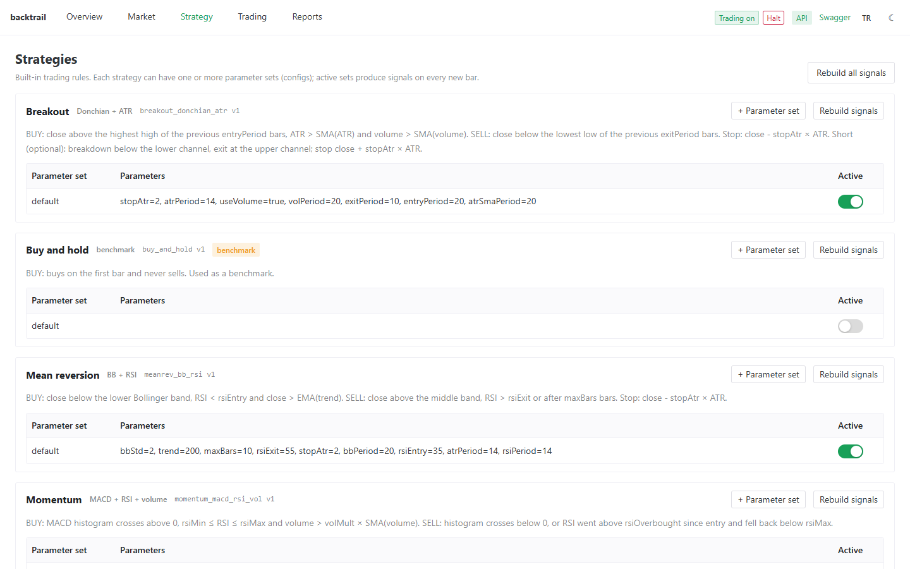
      </picture>
      <p align="center"><sub><b>Strategies</b>: rules and parameter sets</sub></p>
    </td>
    <td align="center">
      <picture>
        <source media="(prefers-color-scheme: dark)" srcset=".github/assets/screenshots/mobile-overview-dark.png"/>
        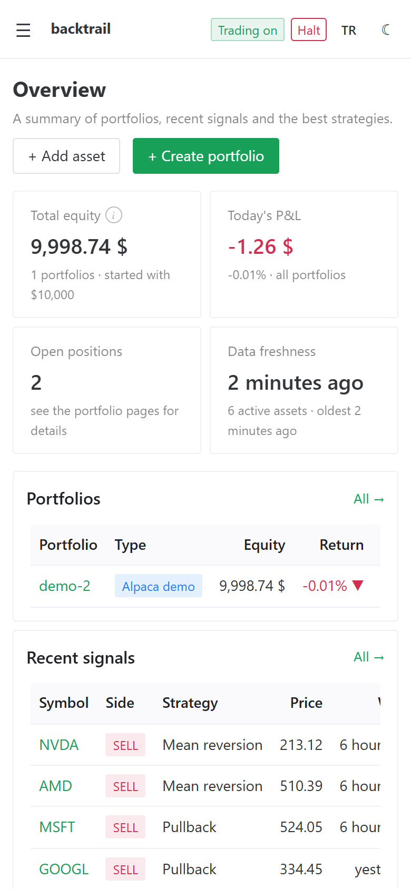
      </picture>
      <p align="center"><sub><b>Phone</b>: the same app at 390 px</sub></p>
    </td>
  </tr>
</table>

<sub>Screenshots follow your GitHub theme (light or dark).</sub>

Prefer the API? Swagger lists every endpoint at `/api/docs`.

## 🔒 Safety first

> [!IMPORTANT]
> backtrail never touches real money. Only Alpaca's **paper** endpoints are accepted; any other broker URL
> stops the app at boot.

- Secrets live only in `.env` (git-ignored), never in the database. Start from `.env.example`.
- The server binds to `127.0.0.1` by default. Use `0.0.0.0` only behind a TLS reverse proxy or tunnel.
- `AUTH_USERNAME` / `AUTH_PASSWORD` turn on HTTP Basic Auth for the API, Swagger and the dev UI. They are
  required once Alpaca keys are set, because the API can then place orders.
- Telegram is optional: set `TELEGRAM_BOT_TOKEN` and `TELEGRAM_CHAT_ID`, then `POST /api/notifications/test`.
  `NOTIFY_LOCALE` (`tr` or `en`) picks the message language.

## 🏗️ Architecture

A modular monolith in NestJS. Each module has a pure-TypeScript `domain/` layer (no framework imports) and
talks to the outside world through ports and adapters. Modules communicate through events
(`asset.created` → `market-data.synced` → `analysis.completed`), and money is calculated with `decimal.js`,
never floats.

```
src/
  config/        typed config + env validation (Joi)
  database/      TypeORM data source and migrations
  common/        errors, auth, logging, shared utilities
  integrations/  Yahoo Finance and Alpaca clients
  modules/
    assets/          symbols, search, commodity ETF proxies
    market-data/     ingestion, 1h → 4h aggregation, schedules, earnings dates
    analysis/        indicators, strategies, signals
    backtesting/     engine, sweeps, walk-forward, Monte Carlo
    trading/         portfolios, paper & Alpaca brokers, risk, kill switch, health
    reporting/       read-only reports
    audit/           audit trail
    notifications/   Telegram
web/             Vue 3 + Vite + Naive UI dashboard (separate npm package)
test/            end-to-end tests against a real PostgreSQL
```

Module rules are in [`src/modules/README.md`](src/modules/README.md).

## 🧪 Development

```bash
npm test              # unit tests
npm run test:e2e      # end-to-end tests (needs Postgres)
npm run lint
```

External services (Yahoo, Alpaca, Telegram) are replaced by fakes in the e2e suite, so tests never hit the
network. Strategy tests run on real gold futures (GC=F) data.

## 🧭 Limitations

- US-listed equities, ETFs, indexes and futures only.
- Strategies trade 4h bars; Yahoo's hourly history goes back about two years.
- One position per asset per portfolio; no partial sells.
- Backtests are single-asset; paper portfolios are multi-asset.

## ⚠️ Disclaimer

- **Not investment advice.** backtrail is a personal simulation and research project. Nothing it shows (signals,
  strategy rankings, backtests, reports or notifications) is a recommendation to buy, sell or hold any
  security, futures contract or other instrument.
- **Simulation only.** All trading is simulated: internal paper portfolios or a broker's paper (demo) account.
  Live trading is disabled on purpose. No real orders are placed and no real money is at risk.
- **Past performance does not predict future results.** Backtests are hypothetical. They depend on historical
  data, assumed fees and slippage, and fills that real markets may not give you. Good backtest numbers can
  come from overfitting.
- **Data can be wrong or late.** Market data comes from free third-party sources (Yahoo Finance, SEC EDGAR),
  may be delayed, incomplete or incorrect, and is not meant for trading decisions.
- **No warranty.** The software is provided as is. The author is not responsible for any loss or decision
  made based on it. Talk to a licensed financial professional before investing.

---

<div align="center">
<sub>Simulation software for research and education. Not financial advice. Use at your own risk.</sub>
</div>
